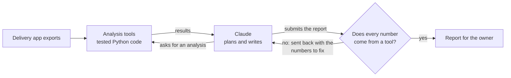

# Promo Profit Lab

An AI agent that reads a restaurant's delivery-app data and answers one question: **is this discount making us money,
or just more orders?**


## The problem

Restaurants on Deliveroo, Glovo and Just Eat can launch a discount in two clicks, and the app shows them that orders
went up. It doesn't show what happened to profit.

A discount costs more than it looks. The platform commission, the ingredients and the packaging stay the same, so a
20% price cut can take a much bigger bite out of what the restaurant keeps. Take a €10 dish with a 30% commission and
€3 of food and packaging: at full price the restaurant keeps €4.00, at 20% off it keeps €2.60. To earn the same money
it needs **54% more orders**. Most promos never get there, and nobody checks.

## Where this comes from

My co-founder Christian and I started a small analytics service for restaurants in Milan. Our first pilot was a tapas
restaurant that shared four months of Deliveroo data with us.

We analysed the data by hand and sent the owner a report. It covered:

1. **Summary**: total revenue, dishes sold, revenue per dish, and how much of it comes from a few categories.
2. **Sales over time**: revenue every two weeks, the best and the weakest period.
3. **Menu mix**: which categories bring in the money.
4. **Top dishes**: the best sellers, marked as *high volume* (they sell a lot) or *high value* (they earn a lot with fewer
   sales).
5. **Slow sellers**: dishes that rarely sell, each with a possible reason to check (price, visibility, a confusing name).
6. **Open questions**: what we could not answer yet, and which data would let us answer it.

The report was useful, but it only described the past. It could not say whether the discounts the restaurant was
running were worth it. That needs margins, a fair comparison between nights with and without the promo, and an honest
view of how uncertain the answer is. Promo Profit Lab is that next step.

## What the agent does

You give it the raw files exported from the delivery app. The agent:

1. **Checks the data**: what files are there, what is missing, and which questions the data can actually answer.
2. **Rebuilds the report above**: sales over time, menu mix, top dishes and slow sellers, with the same labels and
   structure the owner already knows.
3. **Judges the promo**: how much margin the discount gives away, how many extra orders it needs to break even, how many
   it actually brought, and the result in euros.
4. **Says what to do next**: keep the promo, stop it, or run a short on/off test of a given length when the data is not
   enough to decide. It also checks whether paid ads cover their cost.

It then writes the report in plain Italian (or English) for the owner.

### How it works

Claude, through the Anthropic API, is the brain of the agent. It decides which analyses to run and in what order, reads
the results and writes the report. It never does the maths itself: every number comes from a set of tested Python
functions that the agent calls as tools.



Two safeguards keep the agent honest:

- **Numbers are checked.** Before a report is accepted, a checker finds every number in the text and looks for it in
  the tool results. If the agent wrote a figure no tool produced, the report goes back to it with the list of
  figures to fix.
- **"Not enough data" is a valid answer.** With three or four orders a night, it often takes weeks to tell whether a
  promo works. In that case the agent says so and proposes a test, instead of guessing. It only calls a promo
  profitable (or not) when it is at least 90% sure.

The agent can use these tools:

| Tool | What it answers |
|---|---|
| `inspect_data` | What data do we have, what is missing, which questions can we answer? |
| `sales_trend` | How did sales go, period by period? |
| `menu_performance` | Which categories and dishes carry the business, and which dishes rarely sell? |
| `sales_overview` | How many orders a night, on which days and at what time? How big is the average order? |
| `unit_economics` | How much does each order earn with and without the discount, and how many extra orders does the discount need? |
| `estimate_promo_uplift` | How many more orders came in on promo nights than on similar nights without it? |
| `evaluate_promo` | Did the promo earn or lose money, and how sure are we? |
| `plan_experiment` | If we can't tell yet, how long should an on/off test run? |
| `evaluate_ads` | Do paid ads bring in more than they cost? |

## How we know it works

With real data you never know the true effect of a promo, so you can't check whether the agent got it right. So the
project includes a simulator that creates fake restaurants where we decide the answer in advance: we set how much the
promo really boosts orders, generate months of orders, and export them in the same format as Deliveroo. Then the agent
analyses them without knowing the answer, and we compare.

The test set has 12 restaurants, each simulated 3 times with different random data (36 cases). It includes promos that
clearly pay off, promos that clearly lose money, borderline cases, restaurants with too little history, one that never
ran a promo, and one with the food-cost file missing.

| What we measure | Simple baseline | Claude agent |
|---|---|---|
| Right answer, when it commits to one | 91% | to be run (`make eval-live`) |
| Cases where it commits instead of saying "not enough data" | 64% | |
| Told the owner to keep a promo that loses money | 1 of 36 | |
| Reports where every number comes from a tool | 100% | |
| Warned that food costs were estimated, when they were missing | 100% | |
| Ran the same analyses as the hand-made report | 100% | |

The "simple baseline" runs the same tools in a fixed order and fills in a template. It needs no AI and sets the bar the
Claude agent has to beat: the question is whether the agent stays as accurate while adapting to messy, incomplete data,
and at what cost. Full results case by case: [`evals/scripted-baseline.md`](evals/scripted-baseline.md).

## Try it

```bash
pip install -e ".[app,dev]"
make data      # create a fake restaurant's export files in data/synthetic/demo
make analyze   # run the agent in the terminal
make demo      # open the web demo
make test      # run the tests
```

Without an API key, the simple baseline runs. To use Claude, set `ANTHROPIC_API_KEY` and run
`promolab analyze data/synthetic/demo --policy claude --trace` to see every step the agent takes.

The web demo has four tabs: run the agent, a break-even calculator for a single dish, a planner for how long a test
should last, and the test results.

## Under the hood

For readers who want the details:

- **Margins** (`margins.py`): what the restaurant keeps per dish is price × (1 − commission) − food − packaging. The extra
  orders needed to break even are (margin at full price ÷ margin with discount) − 1. Also covers 2-for-1 offers and a
  minimum margin per dish.
- **Promo effect** (`uplift.py`): compares promo and non-promo nights with a Poisson regression that accounts for the day
  of the week and any trend. Tested on 60 simulated restaurants: the 90% range contains the true effect at least 80% of
  the time, and it rarely finds an effect that isn't there.
- **Test length** (`experiments.py`): how many nights an on/off test needs, checked against simulation. Promo and normal
  nights alternate within the same weekday so that Fridays are compared with Fridays.
- **Hand-made report analyses** (`descriptive.py`): sales by period, menu mix, top dishes and slow sellers.
- **Simulator** (`simulate.py`): nightly orders, weekday and hourly patterns, basket mix, ads and a known promo effect,
  saved in the same Italian file format as Deliveroo.

## Limits

- It measures the effect on the whole restaurant, not dish by dish: with a few orders a night, dish-level estimates
  would be noise.
- It can't see orders a promo steals from other days or other apps; it takes an assumption for that.
- It assumes the restaurant pays for the discount and the commission is charged on the discounted price. Both depend on
  the contract.
- The fake restaurants are modelled on one pilot. They show the method works when its assumptions hold, not that they
  hold everywhere.

## Data and privacy

Everything in this repository is fake data. The pilot restaurant's files are not included, and `data/private/` is
excluded from git. The simulator only borrows general patterns (dinner-only service, a few orders a night, busy Fridays
and Saturdays) and uses an invented menu.

## Credits

Built by **Andrea Guglielmini** and **Christian**, from the restaurant-analytics project we started together. The
decision framework behind the maths is in [`docs/framework.md`](docs/framework.md), and the pilot story in
[`docs/case_study.md`](docs/case_study.md).

## Project structure

```
src/promolab/
  ingest.py        reads the delivery-app exports and recognises each file
  descriptive.py   the analyses from the hand-made report
  margins.py       margins and break-even
  uplift.py        effect of the promo on orders
  experiments.py   length and schedule of an on/off test
  ads.py           are ads paying for themselves
  simulate.py      fake restaurants with a known answer
  tools.py         the tools the agent can call
  grounding.py     checks that every number in a report came from a tool
  agent.py         the agent, plus the simple baseline
  evals/           test restaurants and scoring
app/streamlit_app.py   web demo
data/synthetic/demo/   one fake restaurant's export files
docs/                  framework, case study, screenshots
evals/                 saved test results
tests/
```

MIT licence.
