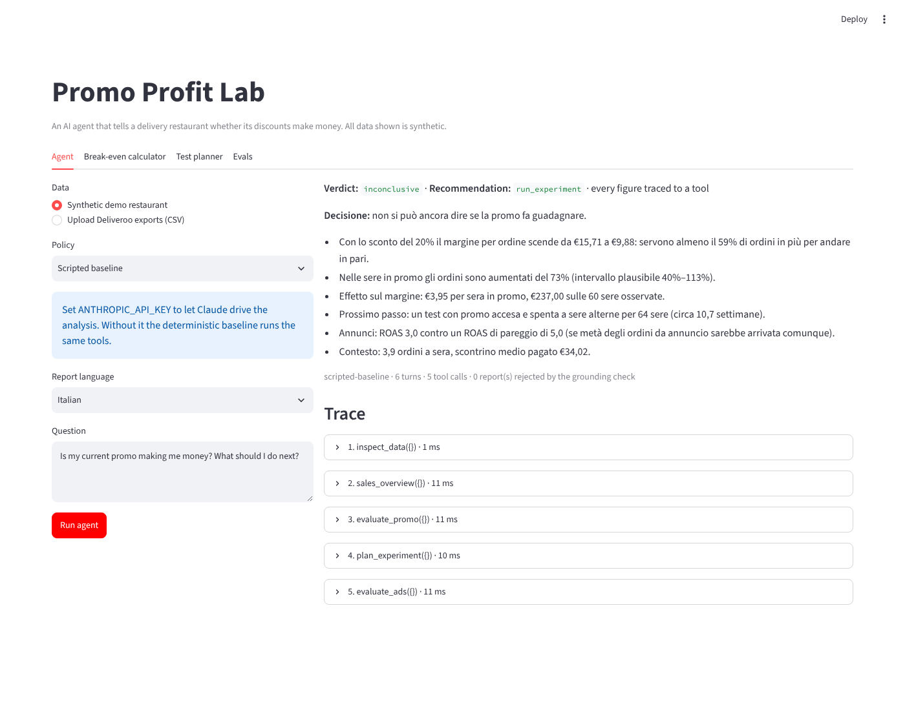
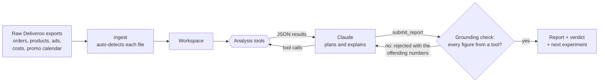

# Promo Profit Lab

**An AI agent that tells a delivery restaurant whether its discounts make money, and what to test next.**

Restaurants on Deliveroo, Glovo and Just Eat launch promotions from the app and see orders go up. They don't see margin.
A 20% discount on a €10 dish with a 30% platform commission cuts the restaurant's take from €4.00 to €2.60, so it needs
**54% more orders just to break even**. In the pilot behind this project, most orders went through a discount and nobody
could say whether that was earning or burning money.

The owner drops the raw platform exports in a folder. The agent works out what data it has, checks the business,
measures the promo against the break-even line, and writes a short report in the owner's language. Claude decides
which analyses to run; deterministic, tested code computes every number; a guardrail rejects any report that contains a
figure no tool produced.



## How it works



| Tool | What it computes |
|---|---|
| `inspect_data` | Which exports were found, date range, what is missing (e.g. no food costs) |
| `sales_overview` | Orders per night by weekday and hour, AOV, discount share, top dishes |
| `unit_economics` | Margin per order with and without the discount, break-even uplift, dishes that should never be discounted |
| `estimate_promo_uplift` | Lift on promo nights vs. comparable nights (quasi-Poisson GLM, weekday + trend), with a 90% interval |
| `evaluate_promo` | Verdict: P(uplift > break-even) and the profit change per promo night in euros |
| `plan_experiment` | Nights of a promo on/off switchback test needed to detect the break-even uplift, plus a randomised schedule |
| `evaluate_ads` | ROAS vs. the ROAS needed to pay back, given the margin |
| `submit_report` | Final structured answer (verdict, recommendation, test length, report). Checked before it is accepted |

### Design choices

- **The model plans, code computes.** The LLM never does arithmetic; it chooses tools, reads results and explains them.
  Grounding is enforced, not requested: `grounding.py` parses every figure in the report (Italian and English number
  formats, percentages, rounding) and bounces the report back with the list of untraceable numbers.
- **"I don't know yet" is a valid answer.** With 3-4 orders a night, many promos cannot be judged from history. The
  agent then says so and returns a concrete test length instead of guessing. The decision rule commits only when
  P(uplift > break-even) is at least 90% either way.
- **Measured against ground truth.** Real data never tells you the true effect of a promo. Synthetic restaurants do, so
  the agent is scored on decisions, not on how convincing the prose sounds (see Evals).
- **A deterministic baseline runs the same loop.** `ScriptedPolicy` calls the tools in a fixed order and fills a template.
  It needs no API key, keeps CI hermetic, and is the bar the LLM has to beat.
- **Bounded and observable.** Turn limit, rejection limit, and a trace of every tool call with inputs, outputs and latency.

## Quickstart

```bash
pip install -e ".[app,dev]"
make data        # write a synthetic restaurant's exports to data/synthetic/demo
make analyze     # run the agent from the command line (scripted baseline without an API key)
make demo        # Streamlit app: agent, break-even calculator, test planner, evals
make test        # 26 tests
```

To let Claude drive the agent, set `ANTHROPIC_API_KEY`. It uses `claude-opus-5-5` through the Anthropic Messages API
with tool use (`promolab/agent.py`); `promolab analyze <folder> --policy claude --trace` shows each step.

## Evals

`python -m promolab.evals` runs the agent on 12 synthetic restaurants, each replicated with 3 random seeds (36 cases).
The scenarios cover clearly profitable and clearly losing promos, borderline cases, short histories that cannot be
judged, a promo switched on halfway through the period, a restaurant that never ran a promo, and one where the food-cost
sheet is withheld.

| Metric | What it measures | Scripted baseline | Claude agent |
|---|---|---|---|
| Decision accuracy | Correct verdicts among cases where the agent committed | 91.3% | `make eval-live` |
| Coverage | Cases where it committed instead of answering "inconclusive" | 63.9% | |
| Harmful errors | Told the owner to keep a promo that loses money | 1 / 36 | |
| Grounded reports | Every figure in the report traced to a tool result | 100% | |
| Caveat recall | Said food costs were assumed when they were missing | 100% | |
| Uplift error | Mean absolute error of the reported uplift | 14.8 pts | |
| Cost | Tool calls, turns, tokens and seconds per case | 5 calls, 0 tokens | |

Per-case results: [`evals/scripted-baseline.md`](evals/scripted-baseline.md). The baseline is strong on accuracy by
construction (it always runs the right tools); the questions for the LLM agent are whether it keeps that accuracy while
adapting to messy inputs, how often the grounding check has to send a report back, and at what token cost.

## The statistics underneath

- **Margins and break-even** (`margins.py`): `m0 = P(1-f) - c - g`, `m1 = P(1-d)(1-f) - c - g`, `U* = m0/m1 - 1`,
  adjusted to `U*/ι` when only a share ι of the lift is genuinely new demand. 2x1, margin floors and commission charged on
  the full price are handled too.
- **Uplift** (`uplift.py`): Poisson regression fitted by IRLS with weekday effects and a linear trend, standard errors
  inflated by the Pearson dispersion. Tests check that the 90% interval covers the true effect at least 80% of the time
  over 60 simulated restaurants and that the false-positive rate stays near nominal.
- **Test planning** (`experiments.py`): nights per arm from the delta-method variance of a gamma-Poisson rate ratio,
  verified by Monte Carlo against the same estimator; switchback schedule randomised within weekday pairs.
- **Synthetic restaurants** (`simulate.py`): gamma-Poisson nightly demand, weekday and hour profile, basket mix, ads,
  and a known promo effect, written out in the same Italian CSV format as the real Deliveroo Partner Hub exports.

## Limitations

- Restaurant-level effects only. With a few orders a night, dish-level elasticities are noise.
- Cannibalisation across platforms and time slots is a parameter (incrementality), not something the data identifies.
- Promo cost assumes the restaurant funds the discount and commission is charged on the discounted price; both are
  contract terms to confirm per restaurant.
- Synthetic data is calibrated on aggregate patterns from one pilot. It shows the method works when its assumptions
  hold; it does not prove they hold everywhere.

## Data and privacy

Everything in this repository is synthetic. The pilot restaurant's exports are not included and `data/private/` is
git-ignored. The simulator borrows only aggregate shapes (dinner-only service, a few orders a night, Friday and Saturday
peaks) and uses an invented menu.

## Background

Promo Profit Lab grew out of a restaurant-analytics venture co-founded by **Andrea Guglielmini** and **Christian**: we
interviewed restaurant owners in Milan and ran a pilot with a tapas restaurant that shared four months of Deliveroo data.
The decision framework (`docs/framework.md`) and the case study (`docs/case_study.md`) come from that work.

## Repository layout

```
src/promolab/
  ingest.py        parse raw Deliveroo exports (Italian locale), auto-detecting each file
  margins.py       unit economics and break-even
  uplift.py        quasi-Poisson GLM uplift estimate
  experiments.py   sample size, minimum detectable effect, switchback schedule
  ads.py           ROAS vs. break-even ROAS
  simulate.py      synthetic restaurants with a known promo effect
  tools.py         the agent's tools and their JSON schemas
  grounding.py     checks that every figure in a report came from a tool
  agent.py         agent loop, Claude policy, scripted baseline
  evals/           scenario suite and scoring
app/streamlit_app.py
data/synthetic/demo/   one synthetic restaurant's exports
docs/              framework, case study, screenshots
evals/             saved eval results
tests/
```

MIT licensed.
